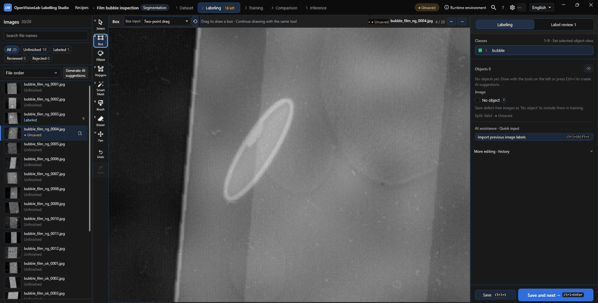
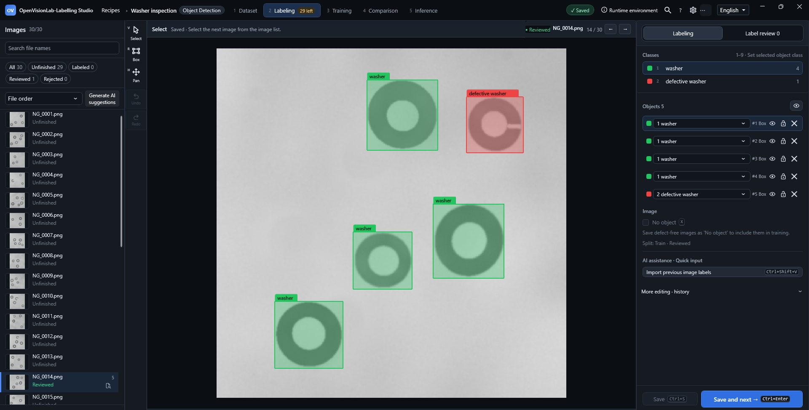
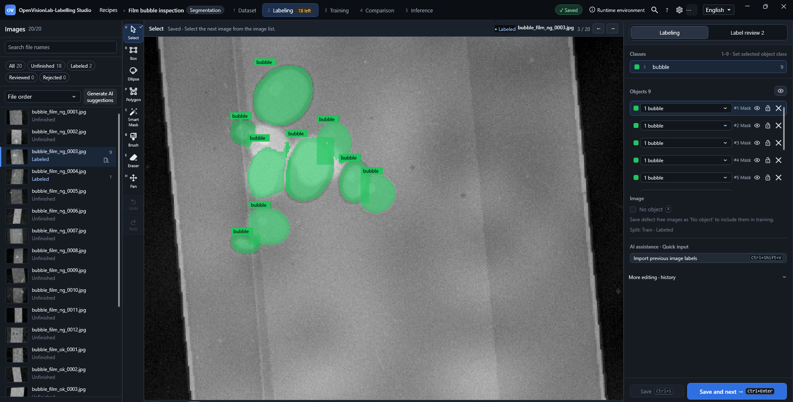
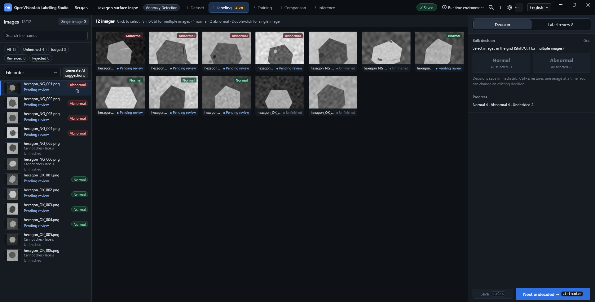

# OpenVisionLab Labeling Studio

A Windows desktop tool for labeling, training, comparing models, and running inference on one PC.

[](Directory.Build.props)

[](LICENSE)

[English](README.en.md) | [한국어](README.md)



Draw a starting box → review the MobileSAM candidate → apply the mask → save and advance. [Watch the MP4](docs/tutorial/images/readme/en/hero-smart-mask.mp4). (Idle time omitted.)

## Supported tasks

| Object detection | Segmentation | Anomaly detection |
| --- | --- | --- |
| [](#object-detection) | [](#segmentation-and-smart-mask) | [](#anomaly-detection) |
| **Ground truth:** axis-aligned boxes | **Ground truth:** polygons and pixel masks | **Ground truth:** reviewed image-level OK/NG decisions |
| **Models:** YOLOv5, YOLOv8, YOLO11 | **Models:** YOLOv8-seg, YOLO11-seg, U-Net | **Models:** YOLOv8/YOLO11 classification, PatchCore pilot |

## Workflow

**Dataset → Labeling → Training → Model comparison → Inference**

Set the image folders, classes, and splits in a recipe. Save ground truth in Labeling, train with the selected runtime, compare results under the same evaluation conditions, and explicitly set the inspection model before running inference.

## AI proposes candidates

AI results are candidates for review.<br>
The operator confirms the result and saves the labels as separate actions.<br>
Setting the inspection model is a separate step; finishing training does not replace it.

## Task details

### Object detection


The actual app shows five saved boxes: four washers and one defective washer.

Draw a box around the actual object or defect, check its class and bounds, then select **Save labels**.
Choose two-point drag or four extreme points; top → bottom → left → right creates an ordinary axis-aligned box.
For an image without a target, explicitly mark **No object**.
Shortcuts: **1–9** selects a class; **Ctrl+Enter** saves and advances to the next image.

### Segmentation and Smart Mask


Nine bubble regions are saved as masks in this film inspection example.

Use polygons, the brush, or the eraser to describe the boundary.
In a segmentation recipe, enable **Automatic contour** in **Labeling options** once. Drawing a starting box then generates a MobileSAM candidate.
If correction is needed, add inclusion or exclusion points one at a time, select **Regenerate candidate**, and compare **Previous candidate** with **Current candidate**.
Select **Confirm** for the displayed candidate or **Skip** to discard it. Confirmation updates the working annotation; **Save labels** writes it to ground-truth files. Candidate generation and switching do not save files. **Ctrl+Enter** saves and advances.

### Anomaly detection


This procedural hexagon example shows manual image decisions: four normal, four anomaly, and four still undecided.

Use **Normal (OK) → Next** or **Anomaly (NG) → Next** to save the image decision and advance to the next unreviewed image.
Boxes and masks are optional. **G** switches the image queue to grid view.
YOLOv8/YOLO11 classification learns from both OK and NG examples; PatchCore learns from reviewed-normal images.
PatchCore returns an image decision, score/threshold, location candidates, and a heatmap. **View heatmap** opens read-only review without changing labels, candidates, or the model.

## Quick start

1. Create a recipe and select object detection, segmentation, or anomaly detection.
2. Select the source image folder and a separate recipe output folder. Check the class names and order.
3. Open Labeling, annotate or review images, and save the labels or OK/NG decisions.
4. Open Training, select the model runtime, run Dataset Health, and check the training settings before starting.
5. Compare trained results under the same evaluation conditions. Explicitly set the inspection model and save the settings.
6. Open Inference, check the model and images, then run inference. Review AI candidates; confirming a candidate and saving labels are separate actions.

See the [step-by-step manual](docs/tutorial/README.md), [visual guide](docs/tutorial/labeling-workbench-tutorial.html), or [single-file guide](docs/tutorial/labeling-workbench-tutorial-standalone.html) for the full workflow.

## Installation and requirements

- Windows 10/11 x64; .NET 8 and WPF; one local operator.
- For source builds: .NET SDK **8.0.421**, pinned by [global.json](global.json), and PowerShell for the scripts below.
- A graphics driver supporting the SharpGL viewer's required framebuffer functions.
- Model-specific local Python environments and weights for training, inference, and MobileSAM assistance.

Build from source using the commands below. Keep the repository's `dll`, local `OpenVisionLab` libraries, and `third_party` assets with their aligned OpenCvSharp managed/native runtime. See [THIRD-PARTY-NOTICES.txt](THIRD-PARTY-NOTICES.txt). Store personal runtime paths in the uncommitted `config/labeling-runtime.local.json`.

## One recipe, multiple models

A recipe shares source images, canonical class order, ground truth, train/valid/test membership, and data/configuration/model provenance across adapters.
Recipe save or training start records a content-based `dsv2-...` dataset version and SHA-256 identities; identical content reuses the version, while changed labels or splits create a new version.
The Dataset view shows the recorded version, and trained-model history records the version used.
In **Training → Runtime**, selecting a registered model switches its Python executable, runtime folder, and communication script together; select the runtime folder if initial discovery fails.
Compare models with matching dataset identities, classes, splits, and evaluation settings; different conditions are shown as differences rather than a ranking.

## For developers

<details>
<summary>Build, run, verify a package, check the environment, and run CI</summary>

### Build Command

Open `OpenVisionLab.LabelingStudio.sln` in Visual Studio, select `OpenVisionLab.LabelingStudio` as the startup project, and build for x64. The other solution projects contain shared libraries.

```powershell
dotnet build .\OpenVisionLab.LabelingStudio.csproj -c Release -p:Platform=x64
```

### Running

Debug build and launch:

```powershell
dotnet build .\OpenVisionLab.LabelingStudio.sln -c Debug -p:Platform=x64
.\scripts\start-labeling-workbench.ps1 -AppMode Debug
```

Publish and run a local Release bundle:

```powershell
powershell.exe -NoProfile -ExecutionPolicy Bypass -File .\scripts\publish-win-x64.ps1 -Configuration Release
.\scripts\start-labeling-workbench.ps1 -AppMode Publish
```

The versioned self-contained folder is `artifacts\publish\Release\win-x64\0.3.7`. The release and publish manifests record source/build identity and the full payload's SHA-256 hashes.

### Package verification

Verify the existing package without changing it:

```powershell
powershell.exe -NoProfile -ExecutionPolicy Bypass -File .\scripts\publish-win-x64.ps1 -Configuration Release -ReleaseVersion 0.3.7 -VerifyOnly
```

### Environment check CLI

```text
OpenVisionLab.LabelingStudio.exe --environment-self-test --json
```

The read-only check runs before WPF startup and emits one JSON document. For PowerShell automation, use `Start-Process -Wait` with redirected standard output. Exit codes are `0` (ready), `2` (needs attention), `64` (invalid arguments), and `70` (check failed).

### CI

[Windows CI](.github/workflows/ci.yml) checks both README files, builds the application, verifies the product version, and checks whitespace. It also builds a versioned self-contained bundle and retains a temporary workflow artifact for non-pull-request runs.

Sample information: `datasets/object-detection/coco128/coco128/README.txt`; [Python TCP protocol and mock-client examples](samples/python_protocol/README.md).

</details>

## Known Limitations

- There is no installer, code-signing package, or completed clean-PC install/upgrade/uninstall validation. A self-contained bundle includes .NET, but still needs compatible graphics and the selected model runtime. Basic or virtualized displays can be incompatible.
- Model runtimes and weights may require separate preparation and are not downloaded without approval. Support requires a registered adapter with compatible class/split/output mapping; an arbitrary GitHub model is not supported merely by its name.
- Local functional evidence does not establish production accuracy, long-run reliability, or takt time. A CI definition alone does not establish a successful hosted run. The manuals identify historical screen dates, not the appearance of the current build.
- Diagnostics use local user storage and explicit support-bundle export; there is no telemetry, cloud support, or automatic upload. The environment CLI cannot validate the Main Viewer's graphics context without opening that viewer and provides no training or inference commands.
- Recipe archive export includes the last saved recipe and full dataset with SHA-256 verification. Unsaved labels, unconfirmed candidates, and active jobs block export. Import uses a new location without overwriting existing data or automatically applying the recipe. Dataset versioning does not copy the full source dataset.
- Crash recovery covers one current image's unsaved boxes, segmentation, and review metadata. Restore/discard is explicit; candidates are excluded and labels still require saving. Drafts older than seven days or with mismatched recipe/dataset/image identity are not used.
- An interrupted explicit multi-file save recovers the last completed state on restart. Corrupt or inaccessible recovery records block workspace entry and produce logs. Process-termination checks do not prove resilience to power loss or storage failure.
- Anomaly AI decisions remain unconfirmed candidates. Only manual OK/NG review or explicitly approved folder-review results become training ground truth. Legacy review files cannot recover missing AI/user provenance.
- PatchCore is a bounded normal-only pilot. Synthetic or small-sample functional checks do not establish field quality; evaluate held-out production data separately from training and validation data.
- MobileSAM supports one starting box per object with multiple inclusion/exclusion points. Bounded tests covered exact metadata boxes, 20% expansion, 10% shrinkage, and 10% diagonal shifts; larger errors, arbitrary shapes, automatic multi-object separation, and field accuracy are unverified. Automatic confirmation/save and text/voice-based labeling are unsupported. The recipe restores the option when reopened. Restoring it does not run inference, confirm candidates, or save labels.
- Cloud accounts, team permissions, deployment pipelines, and camera/PLC control are outside the current product scope.

## Version

Current version: **0.3.7**, from `VersionPrefix` in [Directory.Build.props](Directory.Build.props). See [RELEASE_NOTES.md](RELEASE_NOTES.md) for version history and user-facing changes.

This project is maintained using explicit version numbers.

### Recent version history

#### v0.3.7 (2026-10-26)

- Reorganized the bilingual README and refreshed actual labeling media.

#### v0.3.6 (2026-10-24)

- Preserved Smart Mask selection during candidate regeneration and fixed review-tab keyboard navigation.

#### v0.3.5 (2026-09-16)

- Hardened annotation persistence, recovery, and review/training state transitions.

#### v0.3.4 (2026-09-15)

- Separated WPF workflow responsibilities while preserving bindings and explicit actions.

#### v0.3.3 (2026-09-08)

- Clarified ownership across labeling, review, model, and dataset workflows.

#### v0.3.2 (2026-09-07)

- Consolidated Shell, queue, runtime, review, and model workflow owners.

#### v0.3.1 (2026-09-04)

- Separated presentation, catalog, and persistence-adapter responsibilities.

#### v0.3.0 (2026-08-31)

- Versioned the integrated dataset, labeling, training, and model-comparison workflow.

#### v0.2.1 (2026-08-25)

- Kept the image queue inside the supported 1100×720 minimum workspace.

#### v0.2.0 (2026-08-24)

- Extended Korean/English refresh across supported presentation surfaces without changing workflow state.

## License

Distributed under the [MIT License](LICENSE). Preserve the copyright and license notices in [LICENSE](LICENSE), [NOTICE](NOTICE), and [THIRD-PARTY-NOTICES.txt](THIRD-PARTY-NOTICES.txt) when copying or distributing the software.

Copyright (c) 2026 최노아 (Noah-Choi)
