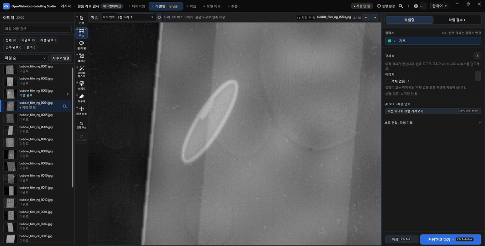
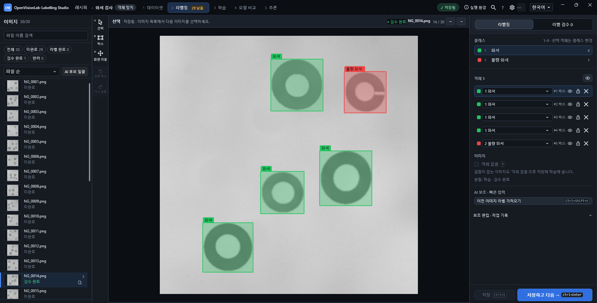
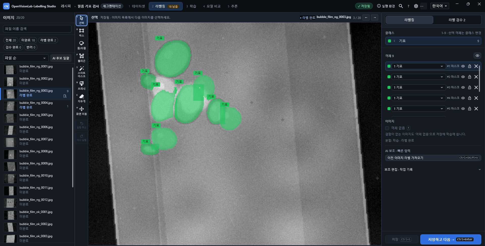
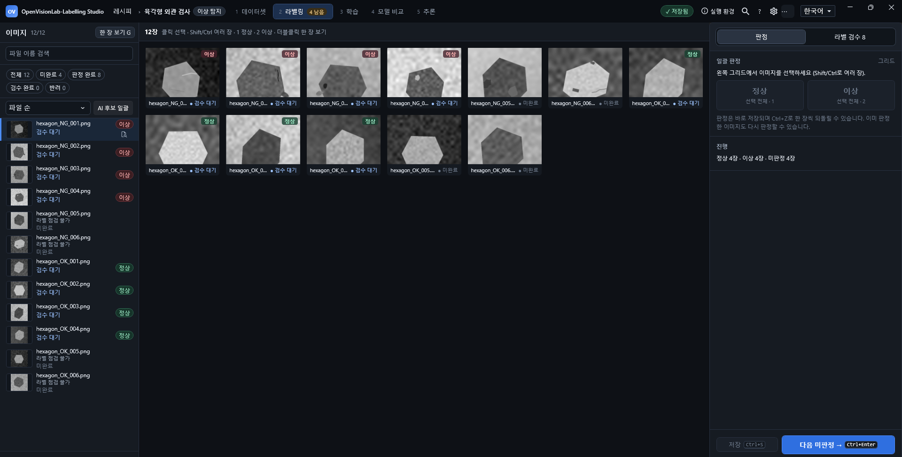
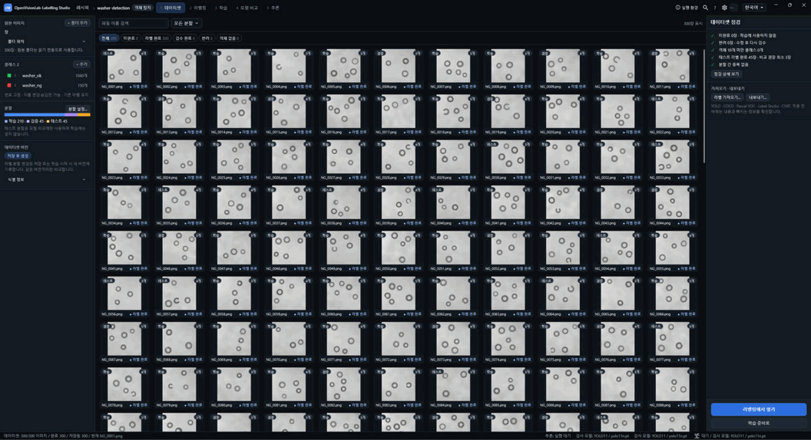
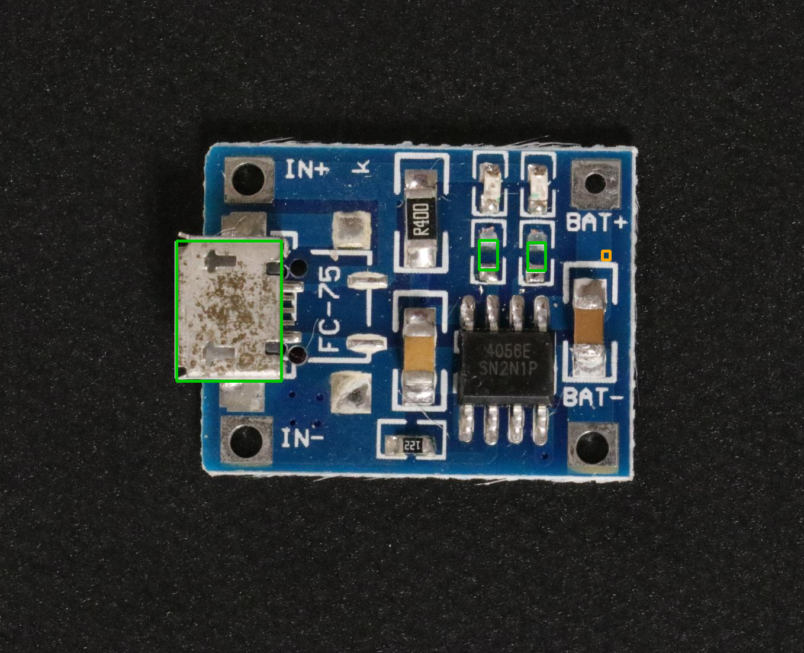

# OpenVisionLab Labeling Studio

한 PC에서 산업 이미지에 라벨을 붙이고 모델을 학습하고 비교한 뒤 추론하는 Windows 데스크톱 도구입니다.

[](Directory.Build.props)


[](LICENSE)
[](https://github.com/Noah8218/OpenVisionLab-Labeling-Studio/actions/workflows/ci.yml)

[English](README.md) | 한국어



시작 박스를 그리면 MobileSAM 후보가 나오고, 후보를 확인해 마스크를 적용한 뒤 저장하고 다음 이미지로 이동합니다. [MP4 보기](docs/tutorial/images/readme/ko/hero-smart-mask.mp4). (대기 구간 생략) [빌드하고 시작하기](#3단계로-시작하기)

## 지원 작업

| 객체 탐지 | 세그멘테이션 | 이상 탐지 |
| --- | --- | --- |
| [](#객체-탐지) | [](#세그멘테이션과-smart-mask) | [](#이상-탐지) |
| **정답:** 축 정렬 박스 | **정답:** 폴리곤과 픽셀 마스크 | **정답:** 검수한 이미지 단위 OK/NG 판정 |
| **모델:** YOLOv5, YOLOv8, YOLO11 | **모델:** YOLOv8-seg, YOLO11-seg, U-Net | **모델:** YOLOv8/YOLO11 분류, PatchCore(시범 기능) |

## 작업 흐름

**데이터셋, 라벨링, 학습, 모델 비교, 추론** 순서로 진행합니다.

레시피에서 이미지 폴더, 클래스와 분할을 설정합니다. 라벨링에서 정답을 저장하고 선택한 실행 환경으로 학습한 뒤, 같은 평가 조건으로 결과를 비교합니다. 검사 모델을 직접 지정한 다음 추론을 실행합니다.

## AI는 후보만 만든다

AI 결과는 검토할 후보입니다.<br>
사용자가 결과를 확정하고, 라벨은 따로 저장합니다.<br>
검사 모델 지정은 별도 단계이며 학습 완료만으로 검사 모델이 바뀌지 않습니다.

## 작업별 상세

### 객체 탐지


실제 앱에서 저장한 박스 5개입니다. 와셔 4개와 불량 와셔 1개를 구분합니다.

실제 객체나 결함을 감싸는 박스를 그리고 클래스와 영역을 확인한 뒤 **라벨 저장**을 누릅니다.
2점 드래그 또는 4점 극점 입력을 선택합니다. 4점 입력은 위, 아래, 왼쪽, 오른쪽 순서로 찍으면 일반 축 정렬 박스를 만듭니다.
대상이 없는 이미지는 **객체 없음**으로 표시합니다.
단축키: **1–9**로 클래스를 선택하고, **Ctrl+Enter**로 저장하고 다음 이미지로 이동합니다.

### 세그멘테이션과 Smart Mask


필름 검사 예제에서 기포 영역 9개를 마스크로 저장한 화면입니다.

폴리곤, 브러시, 지우개로 경계를 만듭니다.
세그멘테이션 레시피의 **라벨링 옵션**에서 **자동 윤곽**을 한 번 켜면 시작 박스를 그릴 때 MobileSAM 후보가 생성됩니다.
보정이 필요하면 포함점이나 제외점을 한 번에 하나씩 추가하고 **후보 다시 생성**을 누른 뒤 **이전 후보 보기**와 **현재 후보 보기**로 비교합니다.
표시된 후보가 맞으면 **확정**, 버리려면 **건너뛰기**를 선택합니다. 확정은 작업 중인 라벨에 반영하며, **라벨 저장**이 정답 파일에 기록합니다. 후보 생성이나 전환만으로는 파일을 저장하지 않습니다. **Ctrl+Enter**로 저장하고 다음으로 이동합니다.

### 이상 탐지


프로그램으로 만든 육각형 예제입니다. 사용자가 정상 4장과 이상 4장을 판정했고, 4장은 아직 판정하지 않았습니다.

**정상 (OK)** 또는 **이상 (NG)** 버튼을 누르면 이미지 판정을 저장하고 다음 미판정 이미지로 이동합니다.
박스와 마스크는 선택 사항입니다. **G**로 이미지 목록을 그리드 보기로 전환합니다.
YOLOv8/YOLO11 분류는 OK와 NG 예시를 모두 사용하며, PatchCore는 정상으로 검수한 이미지로 학습합니다.
PatchCore는 이미지 판정, 점수/임계값, 위치 후보와 히트맵을 반환합니다. **히트맵 보기**는 라벨, 후보, 모델을 바꾸지 않는 읽기 전용 확인 창을 엽니다.

## 3단계로 시작하기

1. `https://github.com/Noah8218/OpenVisionLab-Labeling-Studio.git`를 clone하고 저장소 폴더로 이동합니다.
2. [소스에서 빌드](#소스에서-빌드)의 두 명령으로 앱을 빌드하고 실행합니다.
3. 객체 탐지 레시피를 만들고 `datasets/object-detection/coco128/coco128/images/train2017`을 원본 이미지 폴더로 지정합니다. 별도의 빈 출력 폴더와 클래스를 설정한 뒤 라벨링 화면을 엽니다. 샘플의 라이선스는 [포함된 안내](datasets/object-detection/coco128/coco128/README.txt)를 확인하세요.

Python 실행 환경과 가중치는 학습, 추론, MobileSAM 보조 기능의 모델별 요구 사항입니다. 수동 라벨링에는 필요하지 않습니다.

## 빠른 시작

1. 레시피를 만들고 객체 탐지, 세그멘테이션, 이상 탐지 중 목적을 선택합니다.
2. 원본 이미지 폴더와 별도의 레시피 출력 폴더를 지정하고 클래스 이름과 순서를 확인합니다.
3. 라벨링 화면에서 이미지를 라벨링하거나 검수한 뒤 라벨 또는 OK/NG 판정을 저장합니다.
4. 학습 화면에서 모델 실행 환경을 선택하고 데이터셋 점검과 학습 설정 확인을 마친 뒤 학습을 시작합니다.
5. 같은 평가 조건으로 학습 결과를 비교합니다. 검사 모델로 직접 지정하고 설정을 저장합니다.
6. 추론 화면에서 모델과 이미지를 확인한 뒤 추론을 실행합니다. AI 후보를 검토하며, 후보 확정과 라벨 저장은 따로 합니다.

전체 작업 순서는 [단계별 사용자 매뉴얼](docs/tutorial/README.md), [화면 가이드](docs/tutorial/labeling-workbench-tutorial.html), [단일 파일 가이드](docs/tutorial/labeling-workbench-tutorial-standalone.html)를 참고하세요.

## 설치와 요구 사항

- Windows 10/11 x64, .NET 8과 WPF 기반이며, 작업자 한 명이 한 PC에서 쓰는 환경입니다.
- 소스 빌드에는 [global.json](global.json)이 고정한 .NET SDK **8.0.421**, 제공 스크립트에는 PowerShell이 필요합니다.
- SharpGL 뷰어가 요구하는 framebuffer 함수를 지원하는 그래픽 드라이버가 필요합니다.
- 학습, 추론, MobileSAM 보조 기능에는 모델별 로컬 Python 실행 환경과 가중치가 필요합니다.

아래 명령으로 소스를 빌드합니다. 저장소의 `dll`, 로컬 `OpenVisionLab` 라이브러리, `third_party` 파일, 그리고 버전이 맞는 OpenCvSharp 관리 DLL과 네이티브 DLL을 함께 두세요. [THIRD-PARTY-NOTICES.txt](THIRD-PARTY-NOTICES.txt)를 참고하세요. 개인 실행 환경 경로는 커밋하지 않는 `config/labeling-runtime.local.json`에서 관리합니다.

## 하나의 레시피, 여러 모델

레시피는 원본 이미지, 기준 클래스 순서, 정답, train/valid/test 소속과 데이터, 설정, 모델의 출처를 담고 있어, 어느 모델로 학습하든 같은 기준을 씁니다.
레시피를 저장하거나 학습을 시작하면 내용 기반 `dsv2-...` 데이터 버전과 SHA-256 식별값을 기록합니다. 내용이 같으면 버전을 다시 쓰고, 라벨이나 분할이 바뀌면 새 버전을 만듭니다.
데이터셋 화면은 기록된 버전을 표시하고 학습 모델 이력은 사용한 버전을 기록합니다.
**학습** 화면의 **실행 환경** 탭에서 등록된 모델을 선택하면 Python 실행 파일, 실행 환경 폴더와 통신 스크립트가 함께 전환됩니다. 최초 자동 탐색에 실패하면 실행 환경 폴더를 지정합니다.
데이터 식별값, 클래스, 분할과 평가 설정이 같은 모델을 비교하며, 조건이 다르면 우열 대신 차이를 표시합니다.



같은 데이터 버전으로 YOLOv8n과 YOLO11n을 학습하고, 테스트 분할에서 비교한 뒤, 더 나은 모델을 검사 모델로 지정해 추론합니다. [MP4로 보기](docs/tutorial/images/readme/ko/multimodel-comparison.mp4). (학습 대기 시간 생략)

## 실제 PCB 이미지 결과

VisA PCB4의 실제 PCB 사진 1,105장(1358×1104)으로 위 흐름을 끝까지 실행했습니다. 결함 마스크로 만든 박스를 YOLO 라벨로 가져오고, 데이터셋이 정한 분할(테스트: 불량 40장, 정상 402장)을 그대로 썼습니다. 앱에서 YOLOv8n과 YOLO11n을 학습해 테스트 분할로 비교하고, 엣지 실행 구성에서 TensorRT 엔진으로 바꿨습니다.

| 모델 | mAP50 (앱 모델 비교) | 미검 | 과검 | TensorRT FP16 GPU 계산 시간 |
| --- | ---: | ---: | ---: | ---: |
| YOLOv8n | 0.747 | 3 / 40장 | 4 / 402장 | 0.76 ms |
| YOLO11n | 0.723 | 8 / 40장 | 1 / 402장 | 0.82 ms |



초록 상자는 찾은 결함, 주황 상자는 놓친 결함, 흰 얇은 상자는 정답입니다. 신뢰도 0.25, 입력 960 px, RTX 4070 SUPER 기준입니다. 데이터셋 1종과 테스트 불량 40장의 결과라 생산 정확도의 근거는 아닙니다. 이미지 출처: VisA (Zou et al., ECCV 2022), [CC BY 4.0](https://github.com/amazon-science/spot-diff).

## 소스에서 빌드

Windows 10/11 x64, .NET SDK **8.0.421**, PowerShell이 필요합니다.

```powershell
dotnet build .\OpenVisionLab.LabelingStudio.sln -c Debug -p:Platform=x64
.\scripts\start-labeling-workbench.ps1 -AppMode Debug
```

빌드, 실행, 패키지 검증, 환경 점검, CI의 자세한 내용은 [빌드와 실행 안내(영문)](docs/tutorial/BUILD_AND_RUNTIME.md)를 참고하세요.

## 개발자용

<details>
<summary>빌드, 실행, 배포 검증, 환경 점검, CI</summary>

### 빌드 명령

Visual Studio에서 `OpenVisionLab.LabelingStudio.sln`을 열고 `OpenVisionLab.LabelingStudio`를 시작 프로젝트로 선택한 뒤 x64로 빌드합니다. 솔루션에는 공용 라이브러리 프로젝트도 포함되어 있습니다.

```powershell
dotnet build .\OpenVisionLab.LabelingStudio.csproj -c Release -p:Platform=x64
```

### 실행

Debug 빌드 실행:

```powershell
dotnet build .\OpenVisionLab.LabelingStudio.sln -c Debug -p:Platform=x64
.\scripts\start-labeling-workbench.ps1 -AppMode Debug
```

로컬 Release 번들 게시 및 실행:

```powershell
powershell.exe -NoProfile -ExecutionPolicy Bypass -File .\scripts\publish-win-x64.ps1 -Configuration Release
.\scripts\start-labeling-workbench.ps1 -AppMode Publish
```

버전별 self-contained 폴더는 `artifacts\publish\Release\win-x64\0.4.4`입니다. portable ZIP을 새 폴더에 풀고 manifest를 검증한 뒤 `OpenVisionLab.LabelingStudio.exe`를 실행합니다. release manifest와 publish manifest는 소스와 빌드 식별 정보, 전체 payload의 SHA-256을 기록합니다.

기본 런처는 `Directory.Build.props`의 버전으로 Publish 폴더를 찾으므로 기본 번들에는 로컬 설정이 필요하지 않습니다. 지정한 `-ConfigPath`, `config/labeling-runtime.local.json`, 예제 설정 순서로 적용합니다. 사용자 지정 번들은 [런처 설정](docs/tutorial/BUILD_AND_RUNTIME.md#launcher-configuration)을 참고하세요.

### 배포 검증

기존 패키지를 변경하지 않고 검증합니다.

```powershell
powershell.exe -NoProfile -ExecutionPolicy Bypass -File .\scripts\publish-win-x64.ps1 -Configuration Release -ReleaseVersion 0.4.4 -VerifyOnly
```

### 환경 점검 CLI

```text
OpenVisionLab.LabelingStudio.exe --environment-self-test --json
```

읽기 전용 점검은 WPF 시작 전에 실행하며 JSON 문서 하나를 출력합니다. PowerShell 자동화에서는 표준 출력을 파일로 돌리고 `Start-Process -Wait`로 기다립니다. 종료 코드는 `0`(준비됨), `2`(확인 필요), `64`(잘못된 인자), `70`(점검 실패)입니다.

### CI

[Windows CI](.github/workflows/ci.yml)는 README와 Windows 애플리케이션 빌드, 공백을 검사합니다. 실행별 검사와 산출물은 워크플로에서 확인할 수 있습니다. GPU 검증에는 선택한 실행 환경, 가중치, 데이터가 필요합니다.

샘플 안내: `datasets/object-detection/coco128/coco128/README.txt`, [Python TCP 프로토콜과 mock client 예제](samples/python_protocol/README.md).

</details>

## 문서

- [사용자 매뉴얼](docs/tutorial/README.md), [화면 가이드](docs/tutorial/labeling-workbench-tutorial.html), [단일 파일 가이드](docs/tutorial/labeling-workbench-tutorial-standalone.html)
- [빌드와 개발 안내(영문)](docs/tutorial/BUILD_AND_RUNTIME.md), [버전 이력](RELEASE_NOTES.md)

## 알려진 한계

- 설치 프로그램과 코드 서명 패키지가 없으며, 깨끗한 PC에서 설치, 업그레이드, 제거를 확인하지 않았습니다. self-contained 번들도 호환되는 그래픽 환경이 필요하며 기본 디스플레이나 가상 디스플레이에서는 동작하지 않을 수 있습니다.
- 모델 실행 환경과 가중치는 별도 준비가 필요할 수 있으며 승인 없이 다운로드하지 않습니다. 모델 지원에는 클래스, 분할, 출력 매핑이 맞는 등록 어댑터가 필요합니다.
- 이 PC에서 기능을 확인한 결과로 생산 정확도, 장시간 안정성, 택트 타임을 말할 수는 없습니다. PatchCore는 정상 이미지로만 학습하는 시범 기능입니다.
- AI 결과는 후보입니다. 후보 확정과 라벨 저장은 따로 하며, 자동 확정이나 자동 저장, 텍스트나 음성으로 하는 라벨링은 지원하지 않습니다.
- 클라우드 계정, 팀 권한, 배포 파이프라인, 카메라와 PLC 제어는 현재 제품 범위가 아닙니다.

아카이브, 복구, 진단, 이상 탐지 정답, MobileSAM의 세부 제한은 [실행 안내의 Limitations](docs/tutorial/BUILD_AND_RUNTIME.md#limitations)에 있습니다.

## 버전

현재 버전: **0.4.4** ([버전 원본](Directory.Build.props)), [버전 이력](RELEASE_NOTES.md)

- **0.4.4** — 라벨 가져오기에서 고른 분할을 가져온 이미지의 배정으로 저장해, 레시피를 다시 열어도 비율로 다시 나누지 않습니다. README에 실제 PCB 이미지(VisA PCB4) 결과를 더했습니다.
- **0.4.3** — 여러 YOLOv8/YOLO11 모델을 같은 데이터로 한 대기열에서 차례로 학습하고, 대기열이 끝나면 테스트 분할로 평가합니다. 모델 비교는 A와 B의 차이, 클래스별 AP, 신뢰도별 F1과 재현율, 이미지별 판정 일치를 보여 주고, 같은 데이터 버전에서 평가한 모델 중 하나를 추천합니다. 고른 모델은 두 엔진 중 어느 쪽에서든 검사 모델로 지정할 수 있고, 되돌리기는 이전 모델과 엔진을 함께 복원합니다. 테스트용 와셔 데이터로만 확인했습니다.
- **0.4.2** — 엣지 추론 실행 구성(`Runtime/Edge`)에 운영 기능을 더했습니다. 단계별 프레임 파이프라인, 대체 경로(TensorRT, CPU의 OpenVINO, 부품을 수동 검사로 보류하는 룰 검사), 품질과 GPU 지표, 알람, shadow 비교와 승격 관문과 롤백을 갖춘 릴리스 관리, 재라벨링용 사례 캡처, OPC UA 인증서 보안, 라인별 파라미터 템플릿, C++/CUDA 실행 경로가 들어갔습니다. 요청 측 연결이 끊겨도 워커가 다시 접속합니다. 데스크톱 앱의 동작과 파일 형식은 바뀌지 않았고, 이 구성은 아직 시뮬레이터와 테스트용 데이터로만 확인했습니다.
- **0.4.1** — 별도 엣지 추론 실행 구성(`Runtime/Edge`)을 추가했습니다. 준비한 YOLO 탐지 모델을 ONNX로 내보내고, Linux/WSL2 GPU 컨테이너에서 ONNX Runtime 또는 TensorRT FP32, FP16, INT8 엔진으로 추론합니다. 판정은 Modbus TCP나 OPC UA로 전송하고, 검사 지연 p99는 Prometheus와 Grafana로 표시합니다. 데스크톱 앱의 동작과 파일 형식은 바뀌지 않았습니다. 이 구성은 시뮬레이터로만 확인했으며 Machine Studio 연동은 아직 확인하지 않았습니다.
- **0.4.0** — 수신 이미지 라벨 검토를 위한 선택형 TCP 수신함과 화면 개선

## OpenVisionLab 프로젝트

| 프로젝트 | 역할 |
| --- | --- |
| [2D Workbench](https://github.com/Noah8218/OpenVisionLab) | 규칙 기반 2D 검사 Recipe |
| [3D Studio](https://github.com/Noah8218/OpenVisionLab-3D-Studio) | 3D 티칭, Thickness와 Warpage 측정 |
| [Labeling Studio](https://github.com/Noah8218/OpenVisionLab-Labeling-Studio) | 라벨링, 학습과 모델 비교 |
| [Machine Studio](https://github.com/Noah8218/OpenVisionLab-Machine-Studio) | 하드웨어 준비 전 장비 시뮬레이션 |
| [Vision SDK](https://github.com/Noah8218/OpenVisionLab-Vision-SDK) | 공용 C# 검사 라이브러리 |

## 라이선스

[MIT License](LICENSE)로 배포합니다. 소프트웨어를 복사하거나 배포할 때 [LICENSE](LICENSE), [NOTICE](NOTICE), [THIRD-PARTY-NOTICES.txt](THIRD-PARTY-NOTICES.txt)의 저작권과 라이선스 고지를 유지하세요.

Copyright (c) 2026 최노아 (Noah-Choi)
