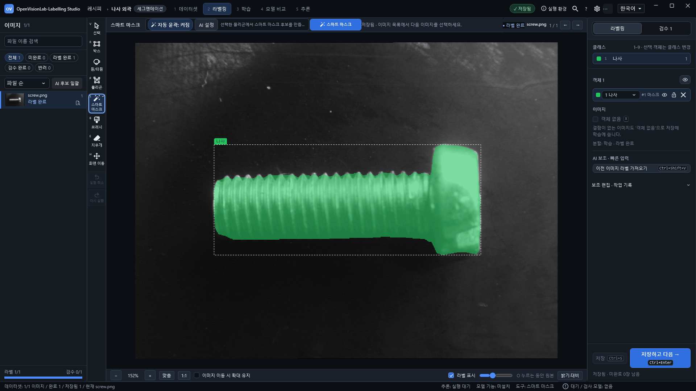
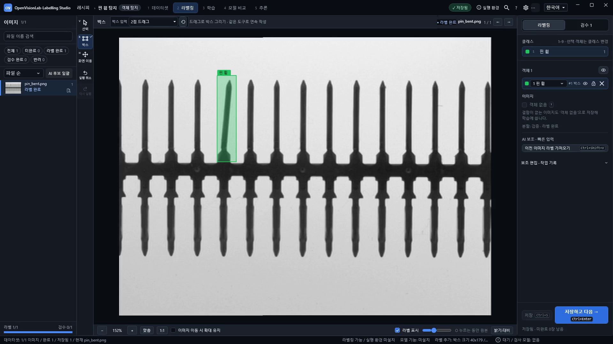
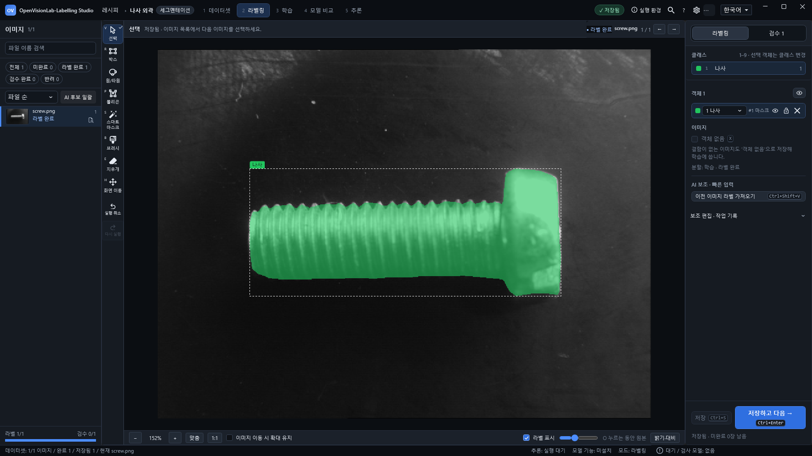
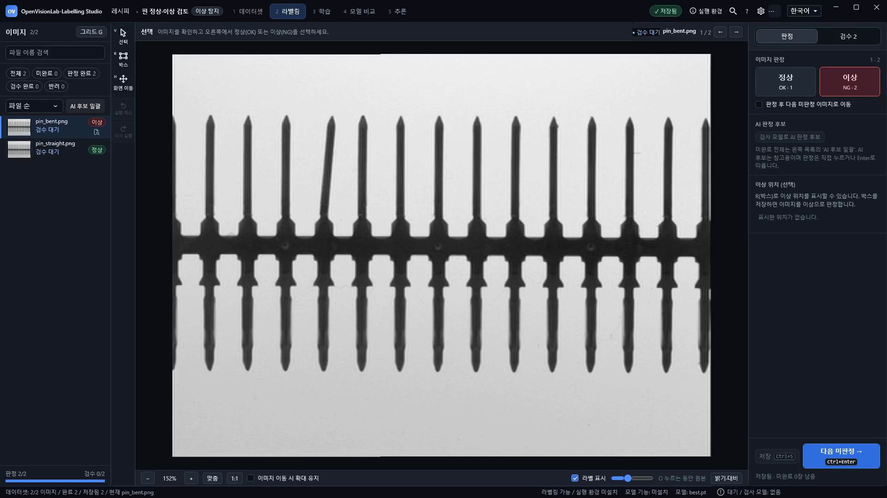

# OpenVisionLab Labeling Studio

[English](README.en.md) | [한국어](README.md)

산업용 이미지 데이터셋 준비부터 라벨링, 학습, 모델 비교, 추론까지 수행하는 로컬 Windows 데스크톱 작업대입니다. .NET 8과 WPF로 구현한 단일 작업자용 애플리케이션입니다.



기존 나사 마스크에서 후보를 다시 생성하고 팝업을 확인한 뒤 적용·저장하는 흐름입니다. 긴 확인 대기만 줄였으며 계산·적용·저장 구간은 실제 경과 시간을 유지했습니다. [MP4 보기](docs/tutorial/images/industrial-workflow/labeling-smart-mask.mp4) · [후보 팝업 보기](docs/tutorial/images/industrial-workflow/labeling-smart-mask-poster.png)

## 1분 요약

하나의 레시피에서 이미지, 클래스 순서, 저장된 정답, 데이터 분할과 모델 이력을 관리합니다. 모델 어댑터가 같은 정답을 각 모델의 학습 형식으로 변환합니다.

| 작업 | 정답과 도구 | 연결된 모델 계열 |
| --- | --- | --- |
| 객체 탐지 | 축 정렬 박스, 2점 드래그 또는 4점 극점 입력 | YOLOv5, YOLOv8, YOLO11 |
| 세그멘테이션 | 폴리곤과 픽셀 마스크, 폴리곤·브러시·지우개·Smart Mask 도구 | YOLOv8-seg, YOLO11-seg, U-Net |
| 이상 탐지 | 검수한 이미지 단위 OK/NG 판정, 위치 표시는 선택 사항 | YOLOv8/YOLO11 classification, PatchCore pilot |

**저장 라벨, AI 후보, 학습 모델, 검사 모델은 서로 다른 상태입니다.** 결과 생성이나 학습 완료만으로 정답이 저장되거나 검사 모델이 바뀌지 않습니다. 로컬 기능 확인은 생산 정확도, 장시간 안정성, takt time을 입증하지 않습니다.

## 바로 시작하기

1. 레시피를 만들고 객체 탐지, 세그멘테이션, 이상 탐지 중 목적을 선택합니다.
2. 원본 이미지 폴더와 별도의 레시피 출력 폴더를 지정하고 클래스 이름과 순서를 확인합니다.
3. 라벨링 화면에서 이미지를 라벨링하거나 검수한 뒤 라벨 또는 OK/NG 판정을 저장합니다.
4. 학습 화면에서 모델 실행 환경을 선택하고 데이터셋 점검과 학습 설정 확인을 마친 뒤 학습을 시작합니다.
5. 같은 평가 조건으로 학습 결과를 비교합니다. 검사 모델로 명시적으로 지정하고 설정을 저장합니다.
6. 추론 화면에서 모델과 이미지를 확인한 뒤 추론을 실행합니다. AI 후보를 검토하며, 후보 확정과 라벨 저장은 별도로 수행합니다.

전체 작업 순서는 [단계별 사용자 매뉴얼](docs/tutorial/README.md)을 참고하세요.

## 라벨링 방식

### 객체 탐지

실제 객체나 결함을 감싸는 박스를 그리고 클래스와 영역을 확인한 뒤 **라벨 저장**을 누릅니다. 대상이 없는 이미지는 **객체 없음**으로 명시합니다. 4점 입력은 위 → 아래 → 왼쪽 → 오른쪽 순서로 일반 축 정렬 박스를 만듭니다.



### 세그멘테이션과 Smart Mask

폴리곤, 브러시, 지우개로 경계를 만듭니다. 세그멘테이션 레시피의 **라벨링 옵션**에서 **자동 윤곽**을 한 번 켜면 시작 박스를 그릴 때 MobileSAM 후보가 생성됩니다.

보정이 필요하면 포함점이나 제외점을 한 번에 하나씩 추가하고 **후보 다시 생성**을 누른 뒤 **이전 후보 보기**와 **현재 후보 보기**로 비교합니다. 표시된 후보가 맞으면 **확정**, 버리려면 **건너뛰기**를 선택합니다. 확정은 작업 중인 라벨에 반영하며, **라벨 저장**이 정답 파일에 기록합니다. 후보 생성이나 전환만으로는 파일을 저장하지 않습니다.

레시피를 다시 열면 옵션이 복원됩니다. 복원 자체가 추론, 후보 확정, 라벨 저장을 실행하지는 않습니다.



### 이상 탐지

**정상(OK) → 다음** 또는 **이상(NG) → 다음**을 누르면 이미지 판정을 저장하고 다음 미판정 이미지로 이동합니다. 박스와 마스크는 선택 사항입니다.



YOLOv8/YOLO11 분류는 OK와 NG 예시를 모두 사용하는 2클래스 지도학습입니다. 제한된 PatchCore pilot은 정상으로 검수한 이미지로 학습하고 이미지 판정, 점수/임계값, 미확정 위치 후보와 히트맵을 반환합니다. **히트맵 보기**를 누르면 읽기 전용 확인 창이 열리며 라벨·후보·모델을 변경하지 않습니다. 생산 품질은 학습·검증에 사용하지 않은 별도 현장 데이터로 평가해야 합니다.

## 하나의 레시피로 여러 모델 사용하기

레시피는 원본 이미지, 기준 클래스 순서, 정답, train/valid/test 소속, 데이터·설정·모델의 출처와 SHA-256 식별값을 공유합니다. 모델마다 별도의 정답을 복사해 수정하지 않고 어댑터가 같은 정보를 재사용합니다.

레시피 저장 또는 학습 시작 시 이미지·라벨의 내용, 클래스 순서와 분할 소속으로 `dsv2-...` 데이터 버전을 기록합니다. 내용이 같으면 기존 버전을 재사용하고, 라벨이나 분할이 바뀌면 새 버전이 됩니다. 데이터셋 화면은 기록된 버전을 표시하고 학습 모델 이력은 사용한 버전을 기록합니다. 원본 데이터셋 전체를 복사하는 기능은 아닙니다.

데이터 식별값(SHA-256), 클래스, 분할과 평가 설정이 같을 때만 모델을 비교하세요. 조건이 다르면 어느 모델이 우수한지 단정하지 않고 차이를 표시합니다.

**학습 → 실행 환경**에서 등록된 모델을 선택하면 Python 실행 파일, 실행 환경 폴더와 통신 스크립트가 함께 전환됩니다. 최초 자동 탐색에 실패하면 실행 환경 폴더를 지정합니다. 등록된 어댑터와 호환되는 클래스·분할·출력 매핑이 있어야 지원하며, GitHub의 임의 모델을 이름만으로 지원하지는 않습니다.

## 설치

- Windows 10/11 x64.
- 소스 빌드에는 [global.json](global.json)이 고정한 .NET SDK **8.0.421**, 제공 스크립트에는 PowerShell이 필요합니다.
- SharpGL 뷰어가 요구하는 framebuffer 함수를 지원하는 그래픽 드라이버가 필요합니다. 기본 또는 가상 디스플레이는 호환되지 않을 수 있습니다.
- 학습·추론·MobileSAM 보조 기능에는 모델별 로컬 Python 실행 환경과 가중치가 필요합니다. 별도 준비가 필요할 수 있으며 승인 없이 다운로드하지 않습니다.

빌드할 때 저장소의 `dll`, 로컬 `OpenVisionLab` 라이브러리와 `third_party` 패키지 자산을 유지하세요. 프로젝트는 저장소에 포함된 OpenVisionLab Core/Vision2D SDK 어셈블리와 버전을 맞춘 OpenCvSharp 관리·네이티브 실행 파일을 사용합니다. 출처가 다른 바이너리로 교체하지 마세요. [THIRD-PARTY-NOTICES.txt](THIRD-PARTY-NOTICES.txt)를 참고하세요.

개인 실행 환경 경로는 커밋하는 설정과 분리한 `config/labeling-runtime.local.json`에서 관리합니다. self-contained 게시 번들은 .NET 실행 환경을 포함하지만, 호환되는 그래픽 환경과 선택한 모델의 실행 환경은 여전히 필요합니다.

## 빌드 명령

Visual Studio에서 `OpenVisionLab.LabelingStudio.sln`을 열고 `OpenVisionLab.LabelingStudio`를 시작 프로젝트로 선택한 뒤 x64로 빌드합니다. 다른 솔루션 프로젝트는 공용 라이브러리와 테스트 실행기입니다.

```powershell
dotnet build .\OpenVisionLab.LabelingStudio.csproj -c Release -p:Platform=x64
```

## 실행

Debug 빌드 실행:

```powershell
dotnet build .\OpenVisionLab.LabelingStudio.sln -c Debug -p:Platform=x64
.\scripts\start-labeling-workbench.ps1 -AppMode Debug
```

로컬 Release 번들 게시 및 실행:

```powershell
powershell.exe -NoProfile -ExecutionPolicy Bypass -File .\scripts\publish-win-x64.ps1 -Configuration Release
.\scripts\start-labeling-workbench.ps1 -AppMode Publish
```

버전별 self-contained 폴더는 `artifacts\publish\Release\win-x64\0.3.4`입니다. portable ZIP은 검증한 폴더를 담은 파일이며 설치 프로그램이나 코드 서명 패키지는 아닙니다. 새 폴더에 풀고 manifest를 검증한 뒤 `OpenVisionLab.LabelingStudio.exe`를 실행합니다. release·publish manifest는 소스·빌드 식별 정보와 전체 payload의 SHA-256을 기록합니다.

## 스모크 검사 명령

게시 후 기존 패키지를 변경하지 않고 검증합니다.

```powershell
powershell.exe -NoProfile -ExecutionPolicy Bypass -File .\scripts\publish-win-x64.ps1 -Configuration Release -ReleaseVersion 0.3.4 -VerifyOnly
```

이어서 읽기 전용 실행 환경 점검을 실행합니다.

```text
OpenVisionLab.LabelingStudio.exe --environment-self-test --json
```

## 화면 없는 실행 환경 점검

실행 환경 점검은 WPF 시작 전에 실행하며 JSON 문서 하나를 출력합니다. 라벨, 레시피, 모델, support bundle을 저장하지 않습니다. Main Viewer를 열지 않으므로 해당 뷰어의 그래픽 컨텍스트는 검증할 수 없습니다.

제품이 Windows GUI 실행 파일이므로 PowerShell 자동화에서는 표준 출력을 파일로 돌리고 `Start-Process -Wait`로 기다려야 합니다. 종료 코드는 `0`(준비됨), `2`(확인 필요), `64`(잘못된 인자), `70`(점검 실패)입니다. 이 제품 CLI는 학습·추론 명령을 제공하지 않습니다.

## 샘플 데이터

| 위치 | 용도 |
| --- | --- |
| `datasets/object-detection/coco128/coco128/README.txt` | 객체 탐지 샘플 데이터 안내 |
| [samples/python_protocol/README.md](samples/python_protocol/README.md) | Python TCP 프로토콜과 mock client 예제 |
| `docs/tutorial/images` | README와 튜토리얼 화면 자료 |

원본 이미지와 레시피 출력을 분리하세요. 다른 모델을 실험할 때도 같은 저장 정답과 분할을 재사용합니다.

## CI

[Windows CI workflow](.github/workflows/ci.yml)가 실행 조건, README·문서 검사, 고정 소스의 테스트 빌드, 회귀 근거와 공백 검사를 정의합니다. 같은 브랜치의 새 실행은 이전 실행을 취소합니다.

수동 `workflow_dispatch`의 `full_regression=true`는 전체 회귀와 버전별 self-contained 게시·패키지 검사를 추가로 실행하고 패키지 artifact를 업로드합니다. GPU 검사에는 적합한 실행 환경·가중치·데이터가 필요하며 필수 조건을 갖추지 못하면 skipped로 기록합니다. workflow 정의만으로 원격 실행 성공을 입증하지는 않습니다.

## 문서

| 문서 | 내용 |
| --- | --- |
| [단계별 사용자 매뉴얼](docs/tutorial/README.md) | 데이터셋 설정, 라벨링, 검수, 학습과 복구 절차 |
| [화면 가이드](docs/tutorial/labeling-workbench-tutorial.html) | 목차, 화면 참조와 문제 해결을 포함한 따라하기 |
| [단일 파일 가이드](docs/tutorial/labeling-workbench-tutorial-standalone.html) | 이미지를 포함한 휴대용 HTML 매뉴얼 |

매뉴얼에는 과거 화면의 기준일이 표시되어 있습니다. 해당 이미지가 현재 빌드의 화면을 입증하지는 않습니다.

## 버전 관리

이 프로젝트는 명시적인 버전 번호로 관리합니다. 단일 기준은 [Directory.Build.props](Directory.Build.props)의 `VersionPrefix`이며 패키지·표시 버전은 이 값에서 생성합니다. 현재 소스 버전: **0.3.6** (2026-10-24). 이전 Public 버전: **0.3.5**.

| 버전 | 날짜 | 변경 내용 |
| --- | --- | --- |
| 0.3.6 | 2026-10-24 | Smart Mask 후보 재생성 중 선택 객체 유지와 WPF 탭 키보드 예외를 수정하고 산업용 실제 작업 미디어를 교체했습니다. 저장 형식과 명시적 적용·저장 경계를 유지합니다. |
| 0.3.5 | 2026-09-16 | annotation 로드·저장·복구, Object Review·검출·학습 상태 전이와 데이터셋 품질·모델 출처·Python 실패 처리를 보강했습니다. 공개 저장 형식은 유지했습니다. |
| 0.3.4 | 2026-09-15 | 수동으로 분산된 WPF Shell 책임을 기능별 View·ViewModel·adapter·lifecycle owner로 옮기고 저장·검수·학습 흐름과 annotation·레시피·데이터 버전·모델 상태의 공개 형식을 보존했습니다. |
| 0.3.3 | 2026-09-08 | WPF Shell·Canvas·Queue·Model 책임을 구체적인 소유자로 정리하고 호출 경로·상태 소유·문서 경계를 기록했습니다. 저장 형식과 모델 상태는 유지했습니다. |
| 0.3.2 | 2026-09-07 | Shell partial과 내부 WPF 책임을 구체적인 소유자로 정리하고 비동기 종료·수명 경계를 보강했습니다. 저장 형식과 모델 상태는 유지했습니다. |
| 0.3.1 | 2026-09-04 | Shell partial 책임을 구체적인 소유자로 옮기고 명령·콜백의 종료 경계를 보강했습니다. 저장 형식과 모델 상태는 유지했습니다. |
| 0.3.0 | 2026-08-31 | 통합 Studio 작업 흐름과 WPF 검수 소유자를 정리하고 저장·검수 동작을 보존했습니다. |
| 0.2.1 | 2026-08-25 | 최소 WPF workspace와 기존 annotation 동작을 호환 가능한 PATCH 후보로 정리했습니다. |
| 0.2.0 | 2026-08-24 | 제한된 WPF 표시와 다국어 후보를 Public 소스에 반영했습니다. |

일반 개발 커밋마다 버전을 올리지는 않습니다. 원본 main 반영은 검토한 변경 묶음별로 새 제품 버전을 사용합니다. 호환 가능한 수정은 PATCH, 기능 추가는 MINOR, 호환성을 깨는 변경은 MAJOR를 사용합니다. 공개한 버전은 변경하지 않으며 소스 push, tag와 Release publication에는 각각 별도 검증·승인 경계가 있습니다.

## 릴리스 노트

사용자에게 영향을 주는 변경은 [RELEASE_NOTES.md](RELEASE_NOTES.md)를 참고하세요.

## 향후 계획

남은 배포 검증에는 승인된 깨끗한 Windows 대상과 설치 프로그램·서명 결정이 필요합니다. 현장 도입에는 승인된 생산 데이터와 목표 하드웨어를 사용한 정확도, 장시간 안정성, takt time의 별도 평가가 필요합니다.

## 알려진 한계

- 설치 프로그램과 코드 서명 패키지가 없으며, 깨끗한 PC의 설치·업그레이드·제거 검증을 마치지 않았습니다. 로컬 패키지 점검만으로 해당 생명주기를 입증할 수 없습니다.
- 진단은 로컬 사용자 저장소와 명시적 support bundle 내보내기를 사용합니다. 텔레메트리, 클라우드 지원과 자동 업로드는 제공하지 않습니다.
- 레시피 아카이브는 마지막으로 저장한 레시피와 전체 데이터셋을 SHA-256 검증과 함께 내보냅니다. 미저장 라벨, 미확정 후보나 진행 중 작업이 있으면 내보내기를 차단합니다. 가져오기는 기존 데이터를 덮어쓰지 않는 새 위치를 사용하며 레시피를 자동 적용하지 않습니다.
- 비정상 종료 복구 범위는 현재 이미지 한 장의 미저장 박스·세그멘테이션·검수 메타데이터입니다. 복구·폐기를 명시적으로 선택하며 후보는 제외하고 라벨 저장도 별도로 해야 합니다. 7일이 지난 초안이나 레시피·데이터셋·이미지 식별 정보가 다른 초안은 사용하지 않습니다.
- 명시적 다중 파일 저장이 중단되면 다음 시작에서 마지막 완료 상태를 복구합니다. 복구 기록이 손상되거나 접근할 수 없으면 작업 화면 진입을 중단하고 로그를 남깁니다. 프로세스 종료 검사는 전원 차단이나 저장 장치 장애에 대한 내성을 입증하지 않습니다.
- 이상 탐지 AI 판정은 미확정 후보입니다. 수동 OK/NG 검수 또는 명시적으로 승인한 폴더 검수 결과만 학습 정답으로 저장합니다. 이전 검수 파일에 없는 AI·사용자 출처는 복원할 수 없습니다.
- PatchCore는 정상 전용 학습을 제공하는 제한된 pilot입니다. 합성 또는 소규모 기능 검사로 현장 품질을 입증할 수 없으며, 학습·검증에 사용하지 않은 생산 데이터를 별도로 평가해야 합니다.
- MobileSAM은 객체마다 시작 박스 하나와 여러 포함·제외점을 지원합니다. 제한된 검사에서 정확한 메타데이터 박스, 20% 확대, 10% 축소와 10% 대각선 이동을 확인했습니다. 더 큰 오차, 임의 형상, 자동 다중 객체 분리와 현장 정확도는 미검증입니다. 자동 확정·저장과 텍스트·음성 기반 라벨링은 지원하지 않습니다.
- 클라우드 계정, 팀 권한, 배포 파이프라인과 카메라·PLC 제어는 현재 제품 범위가 아닙니다.
- HTML/WPF 전체 화면 일치화와 밝기 입력·초기화는 아직 검증 완료로 판정하지 않았습니다. 관련 집중 검사·실제 작업 검수는 전체 회귀 통과를 뜻하지 않습니다.


## 라이선스

[MIT License](LICENSE)로 배포합니다. 소프트웨어를 복사하거나 배포할 때 [LICENSE](LICENSE), [NOTICE](NOTICE), [THIRD-PARTY-NOTICES.txt](THIRD-PARTY-NOTICES.txt)의 저작권·라이선스 고지를 유지하세요.

Copyright (c) 2026 최노아 (Noah-Choi)
